# Enterprise Banking Management System (BMS) - Entity-Relationship Diagram (ERD)

This document contains the complete relational schema design for the 30 core database entities required for the Banking Management System, modeled using PostgreSQL and Prisma.

## 1. High-Level Entity Relationship Diagram (Mermaid)

```mermaid
erDiagram
    %% Identity, Access Control & Organizations
    User ||--o{ UserRole : "assigned"
    Role ||--o{ UserRole : "contains"
    Role ||--o{ RolePermission : "defines"
    Permission ||--o{ RolePermission : "linked"
    User ||--o{ RefreshToken : "holds"
    User ||--o{ AuditLog : "triggers"
    User ||--o{ Notification : "receives"

    Branch ||--o{ Employee : "employs"
    Branch ||--o{ BankAccount : "domiciles"
    Branch ||--o{ CashReconciliation : "reconciles"
    User ||--o| Employee : "profile"
    User ||--o| Customer : "profile"
    Customer ||--o{ Address : "resides"
    Customer ||--o{ BankAccount : "owns"
    Customer ||--o{ AccountBeneficiary : "saves"
    Customer ||--o{ LoanApplication : "submits"
    Customer ||--o{ SupportTicket : "raises"
    Customer ||--o{ ComplianceCase : "subject_of"

    %% Banking & Transactions
    BankAccount ||--o{ Transaction : "source_or_dest"
    BankAccount ||--o{ AccountBeneficiary : "target_account"
    Employee ||--o{ TellerSession : "operates"
    TellerSession ||--o{ Transaction : "processed_in"
    TellerSession ||--o| CashReconciliation : "settled_in"
    Employee ||--o{ CashReconciliation : "verified_by"

    %% Double-Entry Accounting
    Transaction ||--o| JournalEntry : "books_into"
    JournalEntry ||--o{ JournalLine : "contains"
    LedgerAccount ||--o{ JournalLine : "posts_to"
    Branch ||--o{ LedgerAccount : "scopes"

    %% Maker-Checker Approvals
    User ||--o{ ApprovalRequest : "maker_creates"
    User ||--o{ ApprovalRequest : "checker_reviews"
    ApprovalRequest ||--o| Transaction : "gates"
    ApprovalRequest ||--o| LoanApplication : "gates"

    %% Loans & Credit Management
    LoanProduct ||--o{ LoanApplication : "offered_as"
    LoanApplication ||--o{ LoanDocument : "supports"
    LoanApplication ||--o| LoanAccount : "disburses_into"
    BankAccount ||--o{ LoanAccount : "disbursement_target"
    LoanAccount ||--o{ LoanRepayment : "amortizes"

    %% Support & CRM
    SupportTicket ||--o{ SupportMessage : "contains"
    User ||--o{ SupportMessage : "authors"
    Employee ||--o{ SupportTicket : "assigned_to"

    %% Compliance & System
    ComplianceCase ||--o{ AuditLog : "generates"
    Employee ||--o{ ComplianceCase : "investigates"
    User ||--o{ IdempotencyRecord : "locks"

    %% Entity Attributes & Types
    User {
        uuid id PK
        string email UK
        string passwordHash
        string firstName
        string lastName
        string phone
        string status
        int failedLoginAttempts
        timestamp lockedUntil
        timestamp createdAt
        timestamp updatedAt
    }

    Role {
        uuid id PK
        string name UK
        string description
        boolean isSystem
    }

    Permission {
        uuid id PK
        string code UK
        string module
        string description
    }

    Branch {
        uuid id PK
        string code UK
        string name
        string address
        string city
        string state
        string routingNumber UK
        boolean isActive
    }

    Employee {
        uuid id PK
        uuid userId FK, UK
        uuid branchId FK
        string employeeNumber UK
        string jobTitle
        string department
        boolean isActive
    }

    Customer {
        uuid id PK
        uuid userId FK, UK
        string customerNumber UK
        string kycStatus
        string taxIdentifier
        date dateOfBirth
        string occupation
    }

    BankAccount {
        uuid id PK
        string accountNumber UK
        uuid customerId FK
        uuid branchId FK
        string accountType "SAVINGS | CURRENT"
        string status "PENDING | ACTIVE | FROZEN | CLOSED"
        decimal balance "18,4"
        decimal availableBalance "18,4"
        string currency
        decimal overdraftLimit "18,4"
        timestamp openedAt
    }

    Transaction {
        uuid id PK
        string referenceNumber UK
        uuid sourceAccountId FK
        uuid destinationAccountId FK
        uuid tellerSessionId FK
        string transactionType "DEPOSIT | WITHDRAWAL | TRANSFER | LOAN_DISBURSEMENT"
        decimal amount "18,4"
        decimal fee "18,4"
        string currency
        string status "PENDING | PROCESSING | COMPLETED | FAILED | REVERSED | REJECTED"
        string description
        string idempotencyKey UK
        timestamp executedAt
    }

    LedgerAccount {
        uuid id PK
        string code UK
        string name
        string accountType "ASSET | LIABILITY | EQUITY | REVENUE | EXPENSE"
        decimal currentBalance "18,4"
        boolean isActive
    }

    JournalEntry {
        uuid id PK
        string entryNumber UK
        uuid transactionId FK, UK
        string description
        date postingDate
        boolean isBalanced
        timestamp createdAt
    }

    JournalLine {
        uuid id PK
        uuid journalEntryId FK
        uuid ledgerAccountId FK
        string entryType "DEBIT | CREDIT"
        decimal amount "18,4"
        string memo
    }

    ApprovalRequest {
        uuid id PK
        string entityType "TRANSACTION | LOAN | ACCOUNT_CLOSURE"
        uuid entityId
        string action "APPROVE_TRANSACTION | DISBURSE_LOAN"
        uuid makerId FK
        uuid checkerId FK
        string status "PENDING | APPROVED | REJECTED | EXPIRED"
        decimal monetaryValue "18,4"
        string reason
        string reviewNotes
        timestamp reviewedAt
    }

    LoanProduct {
        uuid id PK
        string code UK
        string name
        decimal minAmount "18,4"
        decimal maxAmount "18,4"
        decimal annualInterestRate "5,2"
        string interestMethod "REDUCING_BALANCE | FLAT"
        int minTenureMonths
        int maxTenureMonths
        boolean isActive
    }

    LoanApplication {
        uuid id PK
        string applicationNumber UK
        uuid customerId FK
        uuid loanProductId FK
        uuid branchId FK
        decimal requestedAmount "18,4"
        int tenureMonths
        string purpose
        string status "SUBMITTED | UNDER_REVIEW | RECOMMENDED | APPROVED | REJECTED | DISBURSED"
        uuid assignedOfficerId FK
        string recommendationNotes
    }

    LoanAccount {
        uuid id PK
        string loanNumber UK
        uuid applicationId FK, UK
        uuid bankAccountId FK
        decimal principalAmount "18,4"
        decimal interestRate "5,2"
        decimal outstandingBalance "18,4"
        int totalTenureMonths
        date startDate
        date maturityDate
        string status "ACTIVE | CLOSED | DEFAULTED"
    }

    LoanRepayment {
        uuid id PK
        uuid loanAccountId FK
        int installmentNumber
        date dueDate
        date paidDate
        decimal principalDue "18,4"
        decimal interestDue "18,4"
        decimal totalDue "18,4"
        decimal amountPaid "18,4"
        string status "SCHEDULED | PAID | OVERDUE | PARTIALLY_PAID"
    }

    TellerSession {
        uuid id PK
        uuid tellerId FK
        uuid branchId FK
        decimal openingCash "18,4"
        decimal closingCash "18,4"
        decimal expectedCash "18,4"
        decimal cashDifference "18,4"
        string status "OPEN | CLOSED | RECONCILED"
        timestamp openedAt
        timestamp closedAt
    }

    SupportTicket {
        uuid id PK
        string ticketNumber UK
        uuid customerId FK
        uuid assignedEmployeeId FK
        string subject
        string category
        string priority "LOW | MEDIUM | HIGH | URGENT"
        string status "OPEN | IN_PROGRESS | ESCALATED | RESOLVED | CLOSED"
        timestamp resolvedAt
    }

    AuditLog {
        uuid id PK
        uuid actorId FK
        string action
        string targetEntity
        string targetEntityId
        string ipAddress
        string userAgent
        jsonb metadata
        timestamp createdAt
    }

    ComplianceCase {
        uuid id PK
        string caseNumber UK
        uuid customerId FK
        uuid transactionId FK
        string alertType "LARGE_CASH | UNUSUAL_VELOCITY | SUSPICIOUS_PATTERN"
        string severity "LOW | MEDIUM | HIGH | CRITICAL"
        string status "OPEN | INVESTIGATING | CLEARED | ESCALATED"
        uuid investigatorId FK
        string findings
    }

    IdempotencyRecord {
        uuid id PK
        string key UK
        uuid userId FK
        string method
        string endpoint
        int statusCode
        jsonb responseBody
        timestamp expiresAt
    }
```

---

## 2. Table-by-Table Architectural Specifications

| # | Entity Name | Primary Key | Key Foreign Keys & Unique Constraints | Core Responsibility |
|---|-------------|-------------|---------------------------------------|---------------------|
| 1 | `User` | UUID | `email` (UK) | Authentication principal, credentials, lockout flags |
| 2 | `Role` | UUID | `name` (UK) | RBAC role definitions (10 system roles) |
| 3 | `Permission` | UUID | `code` (UK) | Fine-grained operation authorization tokens |
| 4 | `UserRole` | UUID | `(userId, roleId)` (UK) | Many-to-many relationship of users to roles |
| 5 | `RolePermission` | UUID | `(roleId, permissionId)` (UK) | Mapping of RBAC permissions to roles |
| 6 | `Branch` | UUID | `code` (UK), `routingNumber` (UK) | Physical bank branch hierarchy & routing codes |
| 7 | `Employee` | UUID | `userId` (UK), `branchId` (FK) | Internal bank staff metadata and hierarchy |
| 8 | `Customer` | UUID | `userId` (UK), `customerNumber` (UK) | Banking customer identity and KYC attributes |
| 9 | `Address` | UUID | `customerId` (FK) | Physical and residential addresses for KYC |
| 10 | `BankAccount` | UUID | `accountNumber` (UK), `customerId` (FK) | Customer depository accounts (Savings/Current) |
| 11 | `AccountBeneficiary` | UUID | `customerId` (FK), `beneficiaryAccountId` (FK) | Whitelisted transfer targets |
| 12 | `Transaction` | UUID | `referenceNumber` (UK), `idempotencyKey` (UK) | Financial transactions across accounts |
| 13 | `LedgerAccount` | UUID | `code` (UK) | Double-entry Chart of Accounts (COA) |
| 14 | `JournalEntry` | UUID | `entryNumber` (UK), `transactionId` (UK) | Balanced double-entry financial posting container |
| 15 | `JournalLine` | UUID | `journalEntryId` (FK), `ledgerAccountId` (FK) | Individual debit/credit lines |
| 16 | `ApprovalRequest` | UUID | `makerId` (FK), `checkerId` (FK) | Maker-checker dual-control approval tickets |
| 17 | `LoanProduct` | UUID | `code` (UK) | Loan terms, interest rates, and constraints |
| 18 | `LoanApplication` | UUID | `applicationNumber` (UK), `customerId` (FK) | Customer credit requests undergoing review |
| 19 | `LoanDocument` | UUID | `loanApplicationId` (FK) | KYC/financial proof document attachments |
| 20 | `LoanAccount` | UUID | `loanNumber` (UK), `applicationId` (UK) | Disbursed loan facility and balance tracking |
| 21 | `LoanRepayment` | UUID | `loanAccountId` (FK) | Amortization schedule line items |
| 22 | `SupportTicket` | UUID | `ticketNumber` (UK), `customerId` (FK) | Customer service and dispute cases |
| 23 | `SupportMessage` | UUID | `ticketId` (FK), `senderId` (FK) | Conversation history on support tickets |
| 24 | `Notification` | UUID | `userId` (FK) | In-app user notifications and security alerts |
| 25 | `AuditLog` | UUID | `actorId` (FK) | Append-only forensic audit trail entries |
| 26 | `ComplianceCase` | UUID | `caseNumber` (UK), `customerId` (FK) | Anti-Money Laundering (AML) and CTR cases |
| 27 | `TellerSession` | UUID | `tellerId` (FK), `branchId` (FK) | Cash drawer operational shift tracking |
| 28 | `CashReconciliation` | UUID | `tellerSessionId` (UK), `branchId` (FK) | End-of-day teller cash balancing |
| 29 | `IdempotencyRecord` | UUID | `key` (UK), `userId` (FK) | Zero-duplicate transaction execution records |
| 30 | `RefreshToken` | UUID | `tokenHash` (UK), `userId` (FK) | Revocable session refresh credentials |
