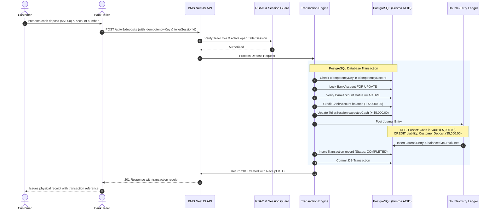
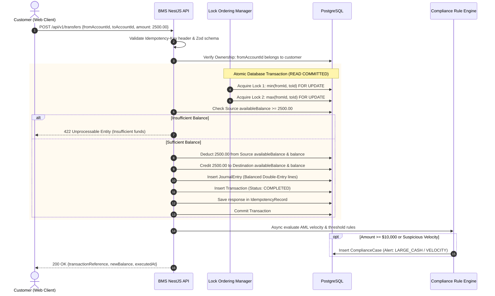
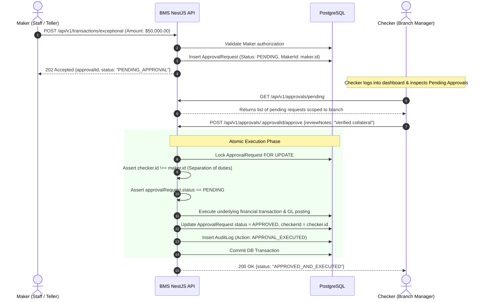
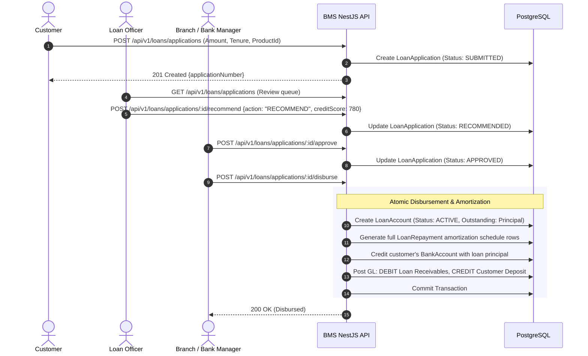

# Enterprise Banking Management System (BMS) - Core Financial Workflows

This document specifies the exact business logic, state machines, and sequence diagrams for the mission-critical workflows of the BMS.

---

## Workflow 1: Teller Cash Deposit & Withdrawal with Dual-Control

### State Machine: Transaction States
`PENDING` $\to$ `PROCESSING` $\to$ `COMPLETED` | `REVERSED` | `FAILED` | `REJECTED`

### Sequence Diagram: Cash Deposit by Teller

---

## Workflow 2: Concurrency-Safe Internal Funds Transfer

### Deadlock-Free Pessimistic Lock Ordering Algorithm
When transferring from Account $A$ to Account $B$:
1. Let $\text{id}_1 = \min(A.\text{id}, B.\text{id})$
2. Let $\text{id}_2 = \max(A.\text{id}, B.\text{id})$
3. Lock account $\text{id}_1$ with `SELECT ... FOR UPDATE`
4. Lock account $\text{id}_2$ with `SELECT ... FOR UPDATE`
This deterministic lexicographical lock acquisition guarantees zero deadlocks even with high-frequency bidirectional transfers between accounts.

### Sequence Diagram: Transfer Execution

---

## Workflow 3: Dual-Control Maker-Checker Approval Workflow

### Operational Threshold Rules
- Routine Transfer $\le \$10,000$: Auto-execute.
- High-Value Transfer $> \$10,000$: Escalate to `ApprovalRequest` (`PENDING`).
- Loan Disbursement (Any amount): Mandatory Maker (Loan Officer) $\to$ Checker (Branch/Bank Manager).

---

## Workflow 4: Loan Origination, Reducing-Balance Amortization & Disbursement

### Reducing-Balance EMI Calculation Formula
Given:
- Principal $P$
- Monthly interest rate $r = \frac{\text{Annual Rate}}{12 \times 100}$
- Number of monthly installments $n$

$$\text{EMI} = P \times \frac{r(1 + r)^n}{(1 + r)^n - 1}$$

For each month $k \in [1, n]$:
- Monthly Interest Due: $I_k = \text{Remaining Balance}_{k-1} \times r$
- Monthly Principal Due: $P_k = \text{EMI} - I_k$
- Remaining Balance: $\text{Balance}_k = \text{Balance}_{k-1} - P_k$

### Sequence Diagram: Loan Lifecycle

